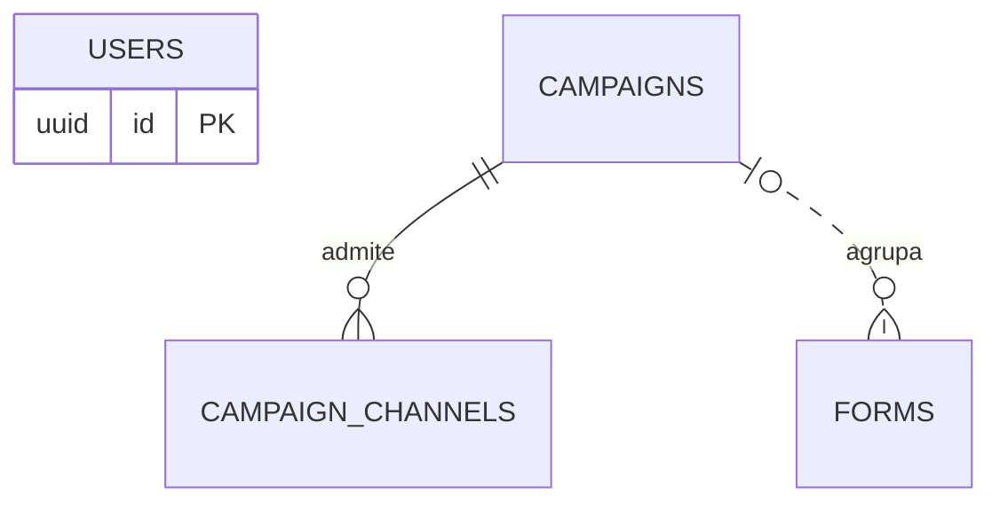
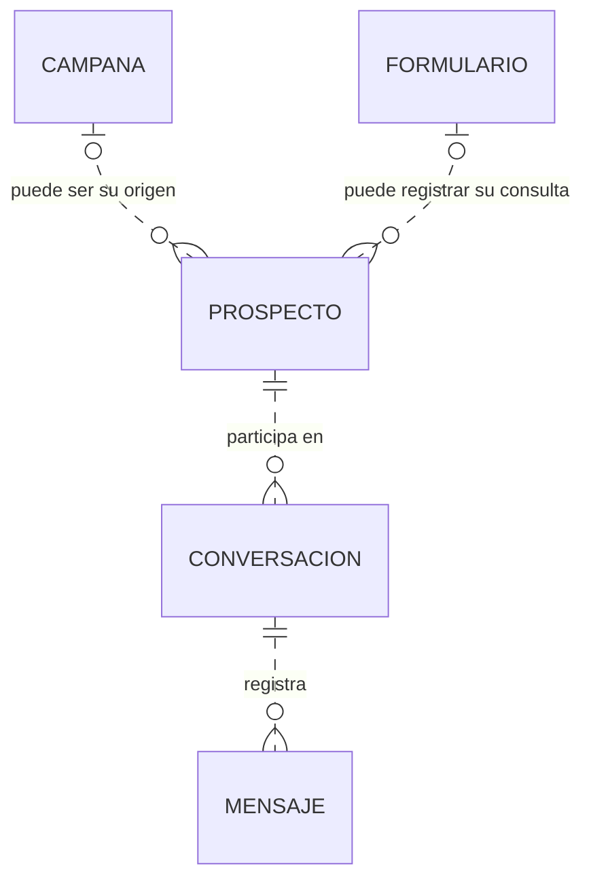

# Modelo de dominio inmobiliario

Una **campaña** identifica una iniciativa comercial. Sus canales indican por dónde pueden llegar las consultas y cada formulario puede quedar asociado a una campaña. Un **prospecto** (lead) es la persona que consulta: no necesita una cuenta de usuario ni un origen identificado.

## Modelo persistido en PostgreSQL

El diagrama muestra las relaciones definidas por las migraciones. `USERS` se mantiene separado: no existe una relación persistida entre las cuentas internas y las campañas o los formularios.

### Diccionario de datos

| Entidad | Campos obligatorios | Campos opcionales | Restricciones |
| --- | --- | --- | --- |
| Campaña (`campaigns`) | `id` (UUID, PK), `name`, `objective`, `status`, `created_at`, `updated_at` | `start_date`, `end_date` | Nombre y objetivo no vacíos. Si se informan ambas fechas, el fin debe ser posterior al inicio. |
| Canal de campaña (`campaign_channels`) | `campaign_id` (UUID, FK), `channel` | — | Solo `form` o `simulated_messaging`. El par `(campaign_id, channel)` es único. |
| Formulario (`forms`) | `id` (UUID, PK), `name`, `created_at` | `campaign_id` (UUID, FK) | Nombre no vacío. Si tiene campaña, esta debe existir. |
| Usuario interno (`users`) | `id` (UUID, PK), `name`, `email`, `password_hash`, `role`, `status`, `created_at`, `updated_at` | — | Correo único sin distinguir mayúsculas y minúsculas; roles `administrador`, `supervisor` y `vendedor`. Se guarda el hash, no la contraseña, y el hash no se expone en las respuestas de usuario. |

Los campos de fecha usan `TIMESTAMPTZ`. En el diagrama, una campaña puede no tener canales o formularios; un canal asociado siempre pertenece a una campaña, y un formulario puede existir sin campaña.

### Estados persistidos

| Entidad | Valores admitidos | Valor por defecto en la base |
| --- | --- | --- |
| Campaña | `draft`, `active`, `paused`, `completed` | `draft` |
| Usuario | `active`, `inactive` | `active` |

Estas restricciones definen valores, no transiciones ni permisos. [Captación](../express/docs/capture-auth.md) requiere un JWT válido y un administrador activo. Las rutas protegidas de usuarios siguen denegadas hasta integrar su autorización.

## Prospectos y calificación: modelo conceptual

Este diagrama expresa relaciones de negocio previstas, **no claves foráneas ni tablas implementadas**. Los nombres de estados acordados tampoco son todavía identificadores de persistencia.

### Origen del prospecto

El [contrato de origen](../express/docs/capture-origin.md) usa `campaignId` (UUID o `null`), `channel` (texto o `null`) y `formId` (UUID o `null`). Los tres pueden ser nulos: no se infiere una campaña ni un formulario a partir de datos ausentes.

- Si se informan campaña y formulario, el formulario debe pertenecer a esa campaña.
- Si se informan campaña y canal, ese canal debe estar asociado a la campaña.

Express deberá comprobar estas combinaciones al registrar un prospecto. Que cada referencia exista no demuestra que sean compatibles entre sí. La representación en PostgreSQL y sus restricciones siguen pendientes de definición.

### Estados e invariantes del negocio

- **Prospecto:** los estados acordados son `nuevo`, `en calificación`, `calificado`, `no calificado`, `asignado` y `cerrado`. Las transiciones, su autorización y los estados de conversación quedan por definir.
- **Conversación y mensajes:** el historial debe distinguir la salida del modelo de los datos validados y aceptados por Express. La IA conversa, extrae datos y resume; no decide el puntaje ni asigna vendedores.
- **Datos declarados:** un dato desconocido no se sustituye por cero ni por una moneda por defecto. Un `null` del gateway no borra un dato previo; si llega un monto nuevo sin moneda, no se reutiliza la moneda anterior. Esto describe el [acuerdo de intercambio](../contracts/T3_COMPATIBILIDAD.md), no un esquema SQL.
- **Calificación:** Express calcula el puntaje con reglas configurables; el modelo previsto conserva la versión de reglas utilizada. Una recalificación aplica una versión de reglas a un conjunto de prospectos.
- **Asignación y notificación:** el supervisor asigna manualmente un vendedor y Express emite la notificación. El modelo previsto conserva el historial de asignaciones y el resultado del envío, sin duplicar efectos ante reintentos.

## Fuentes

- [Migraciones SQL](../express/database/migrations/): esquema y restricciones implementadas.
- [Contrato de origen](../express/docs/capture-origin.md): relación prevista con prospectos.
- [Acuerdos de dominio](DECISIONES_CONFIRMADAS_T1.md) y [compatibilidad con el gateway](../contracts/T3_COMPATIBILIDAD.md): decisiones confirmadas y aspectos pendientes.
- Consigna docente, §§ 2.5 y 5.8: documentación del modelo y requisitos del dominio.
